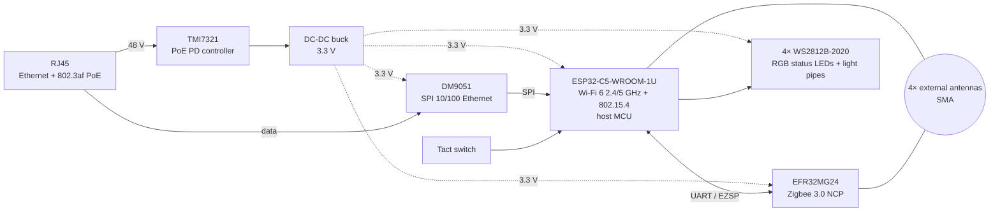

# bitEngine Hub — hardware

Open hardware documentation for the **bitEngine Hub**, a PoE-powered Zigbee 3.0 + Thread gateway
for Home Assistant with two independent 802.15.4 radios, Ethernet / PoE and Wi-Fi 6 uplinks.

> **Status: pre-release.** Schematics are published at the Crowd Supply campaign launch;
> see *What is released* below for the exact scope and timing.

- Product page: <https://home.bitengine.tech>
- ESP32-C5 firmware: [bitengine-hub-firmware](https://github.com/bitEngineTech/bitengine-hub-firmware)
- EFR32MG24 Zigbee NCP: [bitengine-hub-zigbee-ncp](https://github.com/bitEngineTech/bitengine-hub-zigbee-ncp)

## System overview

Four external antennas on SMA connectors, so the Zigbee and Thread radios each get their own
antenna instead of sharing one. The antenna-to-radio assignment is on the schematic.

## Main components

| Function | Part |
|---|---|
| Host MCU, Wi-Fi 6 (2.4 / 5 GHz) + IEEE 802.15.4 (Thread) | Espressif **ESP32-C5-WROOM-1U-N8R8** |
| Zigbee 3.0 radio SoC | Silicon Labs **EFR32MG24B020F1536IM40-B** |
| Ethernet controller (SPI, 10/100) | Davicom **DM9051** |
| PoE powered-device controller (IEEE 802.3af) | TMI (Toll Microelectronics) **TMI7321** |
| Status LEDs | WorldSemi **WS2812B-2020** ×4, with 90° light pipes to the front face |
| Antenna connectors | SMA ×4 |

No external flash: the ESP32-C5 module's 8 MB flash / 8 MB PSRAM and the MG24's internal 1.5 MB
flash are used.

## Enclosure

- Prototype units use a **3D-printed** enclosure.
- Production units use an **aluminum extrusion** enclosure.
- The 3D-printable enclosure files will be released here so the board can be housed in a
  printed enclosure, or the design modified.

## What is released

| Item | Format | License | When |
|---|---|---|---|
| Schematics | PDF | CERN-OHL-P v2 | Crowd Supply campaign launch |
| 3D-printable enclosure | STEP / STL | CERN-OHL-P v2 | Campaign launch (planned) |
| Mechanical outline, connector and programming-interface documentation | PDF / Markdown | CERN-OHL-P v2 | Planned |

**Not released initially:** PCB layout source files and Gerbers, and the tooling files for the
production aluminum extrusion.

## Regulatory

FCC and CE certification are planned for the production design. Prototype units are not
certified, and this repository does not ship any product. The production units will be sold only
after the applicable authorizations are granted.

## License

Copyright 2026 bitEngine.

This hardware documentation is licensed under the **CERN Open Hardware Licence Version 2 —
Permissive** (CERN-OHL-P-2.0). See [LICENSE](LICENSE). You may use the documentation to make and
sell products, with attribution; the licence text has the details.

Firmware is licensed separately, see the firmware repositories linked above.
