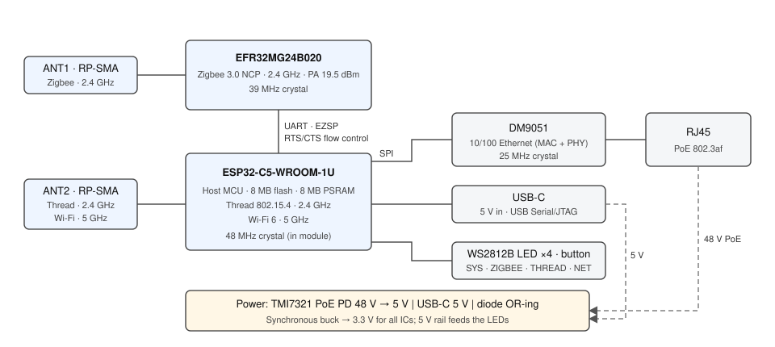

# bitEngine Hub — hardware

Open hardware documentation for the **bitEngine Hub**, a PoE-powered Zigbee 3.0 + Thread gateway
for Home Assistant with two independent 802.15.4 radios, Ethernet with 802.3af PoE (or USB-C
5 V power) and 5 GHz Wi-Fi 6 as an alternative uplink.

> **Status: pre-release.** The block diagram and the interface description are published now;
> schematics follow at the Crowd Supply campaign launch. See *What is released* below for the
> exact scope and timing.

- Product page: <https://home.bitengine.tech>
- ESP32-C5 firmware: [bitengine-hub-firmware](https://github.com/bitEngineTech/bitengine-hub-firmware)
- EFR32MG24 Zigbee NCP: [bitengine-hub-zigbee-ncp](https://github.com/bitEngineTech/bitengine-hub-zigbee-ncp)

## Documentation

- [Block diagram](docs/block-diagram.svg)
- [Interfaces, indicators and specifications](docs/interfaces.md) — connectors, power input,
  radios, status LEDs, button, programming access, environmental ratings

## System overview

Two external antennas on RP-SMA connectors, one per radio: **ANT1** serves the EFR32MG24 Zigbee
radio; **ANT2** serves the ESP32-C5 module's single RF path (the 802.15.4 Thread radio and 5 GHz
Wi-Fi). Zigbee and Thread therefore never share an antenna or a radio. 2.4 GHz Wi-Fi is present
in the ESP32-C5 but disabled in firmware, so that band stays clear for Zigbee and Thread.

Power comes from PoE (TMI7321 PD and DC-DC converter, 48 V to 5 V) or from USB-C 5 V. The two
5 V sources are diode-OR'ed, with PoE taking priority; a synchronous buck converter supplies
3.3 V to all ICs, and the 5 V rail feeds the status LEDs.

## Main components

| Function | Part |
|---|---|
| Host MCU, Wi-Fi 6 + IEEE 802.15.4 (Thread) | Espressif **ESP32-C5-WROOM-1U-N8R8** (5 GHz Wi-Fi used; 2.4 GHz Wi-Fi and Bluetooth LE present but disabled in firmware) |
| Zigbee 3.0 radio SoC | Silicon Labs **EFR32MG24B020F1536IM40-B** |
| Ethernet controller (SPI, 10/100) | Davicom **DM9051** |
| PoE powered-device interface + DC-DC converter (IEEE 802.3af) | TMI (Toll Microelectronics) **TMI7321** |
| Alternative power input | USB-C, 5 V |
| Status LEDs | WorldSemi **WS2812B-2020** ×4 (SYS, ZIGBEE, THREAD, NET), with light pipes |
| Antenna connectors | RP-SMA female (reverse polarity) ×2: ANT1 Zigbee, ANT2 Thread + Wi-Fi |

No external flash: the ESP32-C5 module's 8 MB flash / 8 MB PSRAM and the MG24's internal 1.5 MB
flash are used.

## Enclosure

- Prototype units use a **3D-printed** enclosure.
- Production units use an **aluminum extrusion** enclosure.
- The 3D-printable enclosure files will be released here so the board can be housed in a
  printed enclosure, or the design modified.
- Dimensions, mounting details and connector positions will be published with the enclosure
  files.

## What is released

| Item | Format | License | When |
|---|---|---|---|
| Block diagram | SVG | CERN-OHL-P v2 | Now — [docs/block-diagram.svg](docs/block-diagram.svg) |
| Interface description (connectors, power, radios, LEDs, button, programming access) | Markdown | CERN-OHL-P v2 | Now — [docs/interfaces.md](docs/interfaces.md) |
| Schematics | PDF | CERN-OHL-P v2 | Crowd Supply campaign launch |
| 3D-printable enclosure | STEP / STL | CERN-OHL-P v2 | Campaign launch (planned) |
| Mechanical outline (dimensions, mounting, connector and light-pipe positions) | PDF / Markdown | CERN-OHL-P v2 | With the enclosure files |

**Not released initially:** PCB layout source files and Gerbers, and the tooling files for the
production aluminum extrusion.

## Regulatory

FCC and CE certification are planned for the production design. Prototype units are not
certified, and this repository does not ship any product. The production units will be sold only
after the applicable authorizations are granted.

## License

Copyright 2026 bitEngine, Inc.

This hardware documentation is licensed under the **CERN Open Hardware Licence Version 2 —
Permissive** (CERN-OHL-P-2.0). See [LICENSE](LICENSE). You may use the documentation to make and
sell products, with attribution; the licence text has the details.

Firmware is licensed separately, see the firmware repositories linked above.
